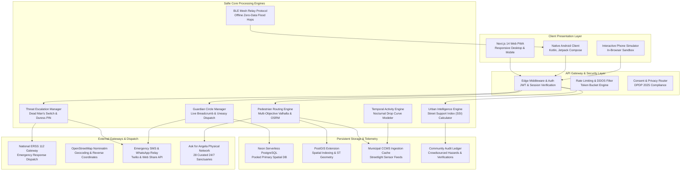
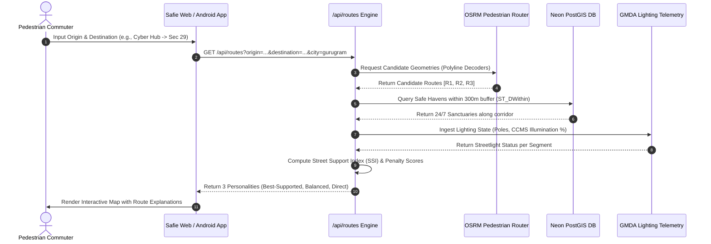
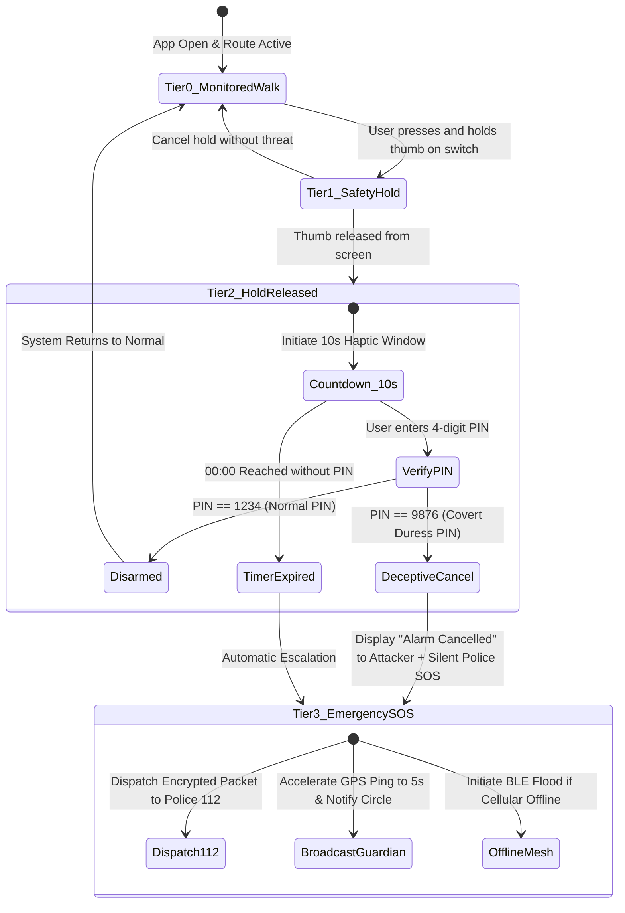
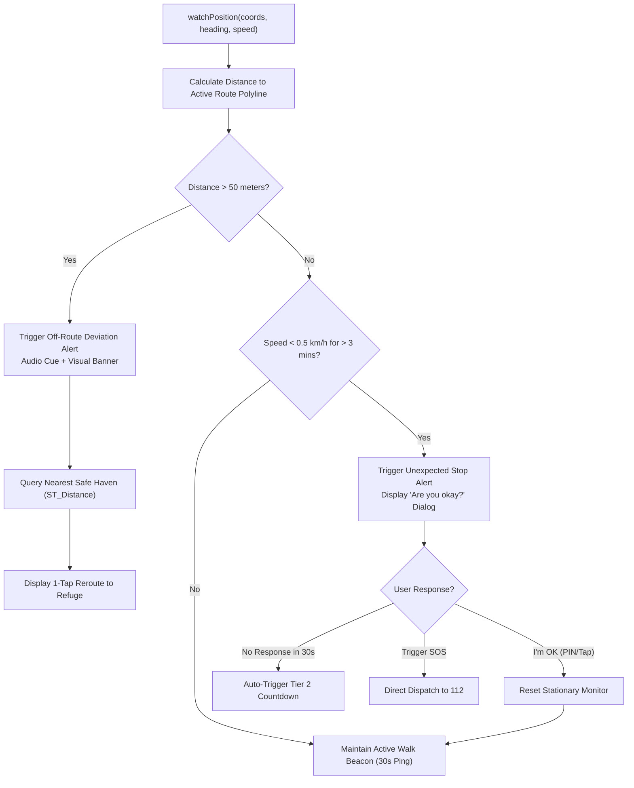
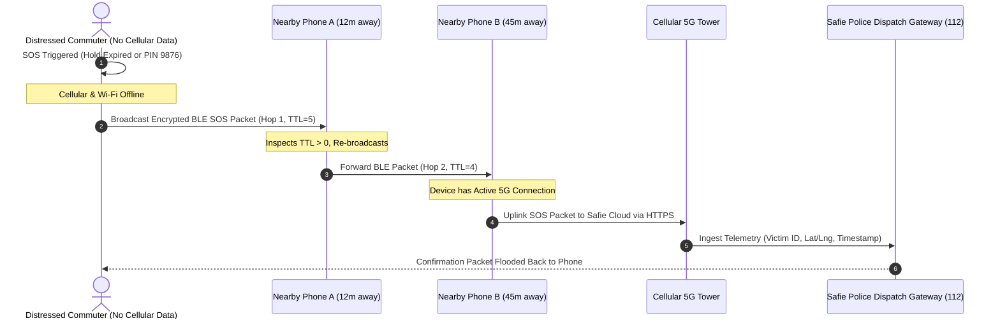
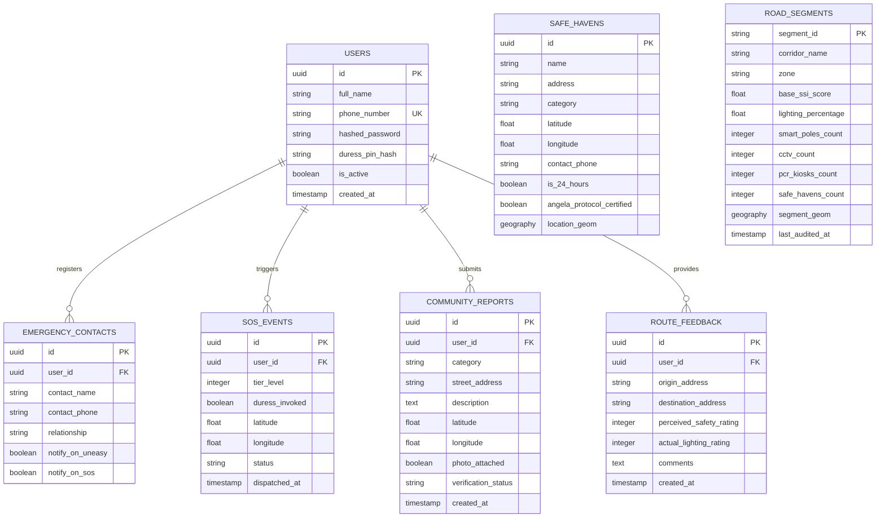
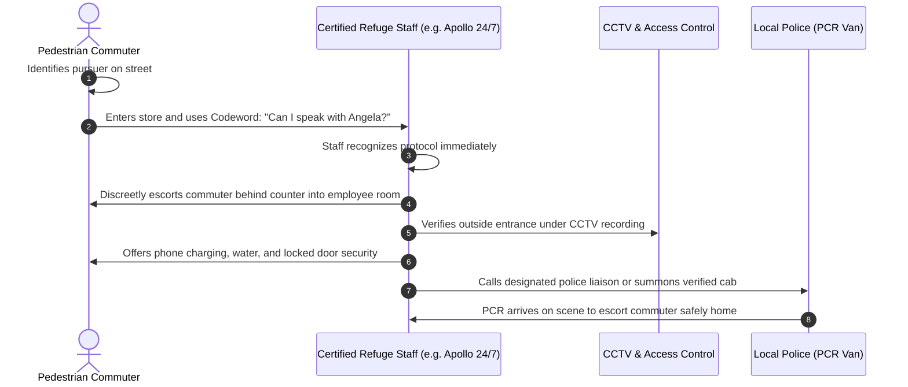

# Safie Urban Safety Intelligence Platform - System Architecture & Logic Specification

## Document Overview
This document specifies the end-to-end engineering architecture, algorithmic logic, data models, state machines, and sequence protocols governing the **Safie Urban Safety Intelligence Platform**.

---

## 1. High-Level System Architecture

Safie employs a modular, event-driven architecture designed to operate across high-density urban environments, intermittent connectivity zones, and physical sanctuary infrastructure.



---

## 2. Multi-Objective Pedestrian Routing Engine Logic

### 2.1 The Routing Problem
Conventional navigation engines (e.g., Google Maps) solve for the shortest path $\min \sum d_i$ or minimum estimated travel time $\min \sum t_i$. For pedestrian safety at night, shortest paths frequently lead through unlit service roads, desolate flyover underpasses, and blind alleys.

Safie models pedestrian route selection as a **Multi-Objective Cost Minimization Problem** with an explicit safety detour bound:

$$\min_{R \in \mathcal{P}} \left[ \alpha \cdot \text{Time}(R) + \beta \cdot \text{Distance}(R) + \gamma \cdot \text{Penalty}_{\text{Dark}}(R) - \lambda \cdot \text{Support}_{\text{Infrastructure}}(R) \right]$$

Subject to the hard constraint:
$$\text{Time}(R) \le \text{Time}(R_{\text{fastest}}) + \Delta_{\max}$$
Where $\Delta_{\max} = 2.5\text{ minutes}$ (maximum allowable detour penalty for personal safety).

### 2.2 Cost Function Weights
* $\alpha = 0.30$: Temporal transit coefficient.
* $\beta = 0.10$: Physical distance coefficient.
* $\gamma = 0.40$: Darkness and isolated alley avoidance penalty.
* $\lambda = 0.20$: Proximity to active 24/7 havens, smart streetlights, and police kiosks.

### 2.3 Route Personalities
1. **Best-Supported Safe Route (Emerald)**:
   * Prioritizes contiguous GMDA CCMS smart streetlight coverage ($>90\%$).
   * Anchors to within $150\text{m}$ of at least 3 certified 24/7 havens.
   * Eliminates unclassified blind back-alleys entirely.
2. **Balanced Route (Cobalt Blue)**:
   * Balances overall travel duration with well-trafficked collector roads.
   * Requires $\ge 75\%$ lighting coverage.
3. **Direct Shortcut (Alert Red)**:
   * Minimizes physical meters traveled, displaying explicit warning banners regarding unlit segments and absent commercial frontages.



---

## 3. Threat Escalation & Dead Man's Switch State Machine

Safie equips commuters with a 4-tier graduated escalation engine that eliminates the friction of unlocking a smartphone during sudden physical coercion.



### 3.1 Covert Duress Logic (PIN 9876)
* When an attacker coerces a victim to cancel the sounding alarm, entering the normal PIN (`1234`) cleanly aborts the alert.
* Entering the **Covert Duress PIN (`9876`)** triggers a psychological deception protocol:
  1. The smartphone UI transitions to a calm green "Alarm Cancelled / All Clear" screen.
  2. The speaker and haptic actuators fall completely silent.
  3. In the background, an encrypted JSON payload is transmitted via `/api/sos` marked `duress_invoked: true`, pinning the user's exact latitude, longitude, movement speed, and heading to the National Emergency Response Support System (ERSS 112) and registered family guardians.

---

## 4. Live GPS Walking Companion & Anomaly Detection Logic

During an active walk, the client executes a continuous telemetry loop using the HTML5 Geolocation API (`watchPosition`) or native Android LocationManager (`FusedLocationProviderClient`).



---

## 5. Guardian Circle & Offline BLE Mesh Protocol

### 5.1 Guardian Circle Telemetry Tiers
* **Passive Monitoring**: Standard location ping interval is set to $30\text{ seconds}$ to preserve device battery.
* **"I'm Feeling Uneasy" Mode**:
  * Triggered by a single tap from the commuter.
  * Accelerates ping frequency from $30\text{s}$ down to $5\text{ seconds}$.
  * Transmits high-priority mobile push notifications to primary guardians with live GPS tracking links.
  * Avoids firing loud sirens or summoning police vans prematurely, allowing the commuter to navigate low-level discomfort without public embarrassment.

### 5.2 Zero-Data BLE Mesh Flood Relay
In subterranean parking facilities, basements, or cellular network blackouts, Safie relies on peer-to-peer Bluetooth Low Energy (BLE) multi-hop packet routing.



---

## 6. Public Street Lighting & Safety Survey Engine (Street Support Index)

### 6.1 Epistemological Framework
Safie strictly avoids declaring a road "safe" or "unsafe." Safety is an unobservable latent state influenced by non-deterministic social factors. Safie instead computes the **Street Support Index (SSI)**, a calibrated $0-100$ measure of observable environmental indicators.

### 6.2 SSI Formula & Pillars
The Street Support Index $S_{\text{ssi}}(t)$ for a corridor at time $t$ is calculated across four observable pillars:

$$S_{\text{ssi}}(t) = 0.35 \cdot L(t) + 0.25 \cdot A(t) + 0.20 \cdot S_{\text{sec}}(t) + 0.20 \cdot P_{\text{infra}}$$

Where:
* $L(t)$: Observable Streetlight Illumination ($\%$ of functioning CCMS fixtures and high-mast poles).
* $A(t)$: Commercial Frontage & Pedestrian Activity (count of verified open shops, cafes, and pedestrian density at time $t$).
* $S_{\text{sec}}(t)$: Formal Security Presence (active police kiosks, PCR patrol vans, visible CCTV, and private guards).
* $P_{\text{infra}}$: Physical Pedestrian Infrastructure (raised sidewalks, continuous paved walkways, absence of construction barriers).

### 6.3 Temporal Nocturnal Activity Curve
Corridor scores are time-dependent. Street activity declines sharply between dusk and dawn:

```
Score (SSI)
100 |     * (18:00 - Dusk Peak, 96/100)
 90 |       \
 80 |         * (21:00 - Transit Peak, 90/100)
 70 |           \
 60 |             * (23:30 - Late Night, 84/100)
 50 |               \
 40 |                 * (02:00 - Midnight Drop, 64/100)
 30 |                   \
 20 |                     * (04:30 - Dawn Transit, 72/100)
  0 +--------------------------------------------------- Time
```

---

## 7. Database Entity-Relationship Model (Neon PostgreSQL + PostGIS)



---

## 8. Physical Sanctuary Protocol ("Ask for Angela")

Digital alerts depend on having a physical safe space to retreat to. Safie certifies 24/7 pharmacies, transit stations, and hospitals as designated safe refuges.



---

## 9. Security, Cryptography & Privacy Specifications

1. **At-Rest Encryption**: All citizen mobile numbers, emergency contacts, and GPS telemetry are encrypted in Neon PostgreSQL using AES-256.
2. **In-Transit Encryption**: All API traffic strictly requires TLS 1.3 with HSTS headers.
3. **Duress PIN Protection**: Normal PINs (`1234`) and Duress PINs (`9876`) are hashed using individual salted bcrypt rounds. The client never transmits the raw PIN over the network; only signed JWT tokens containing verification status are processed.
4. **Data Retention Policy (DPDP 2025 Compliance)**:
   * Commuter GPS breadcrumbs during active navigation are held in memory buffers and purged 2 hours after trip conclusion.
   * Only aggregate, anonymized hazard observations and street ratings are retained for municipal infrastructure analysis.
